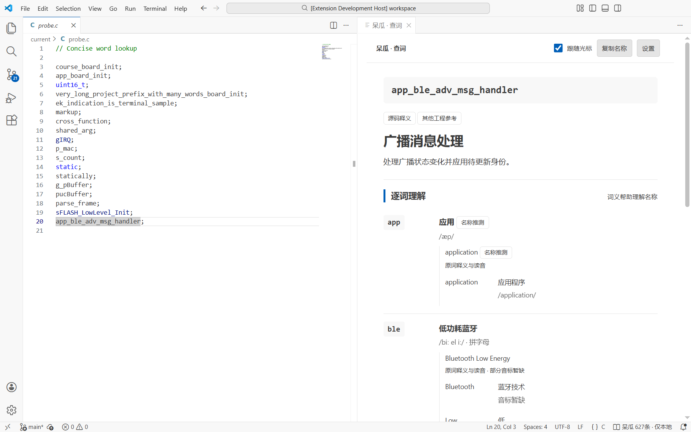
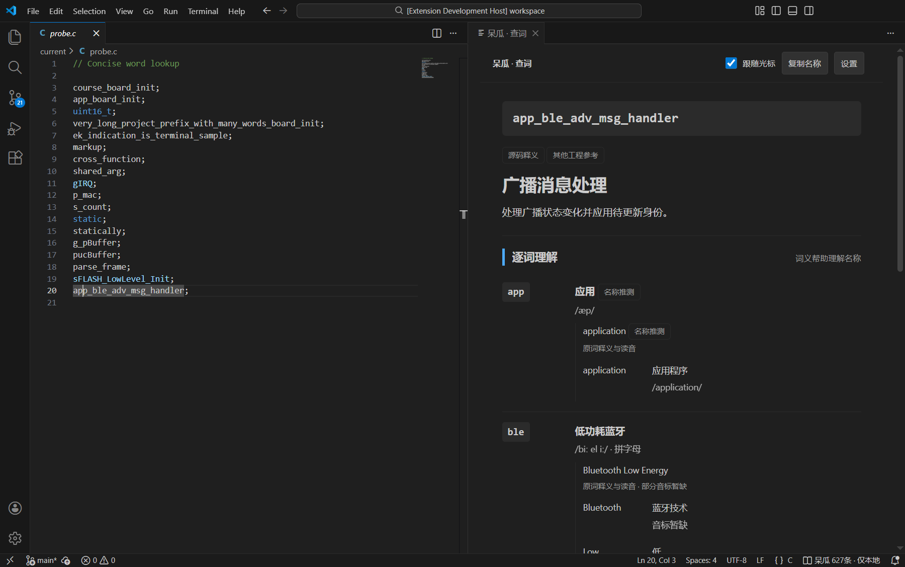
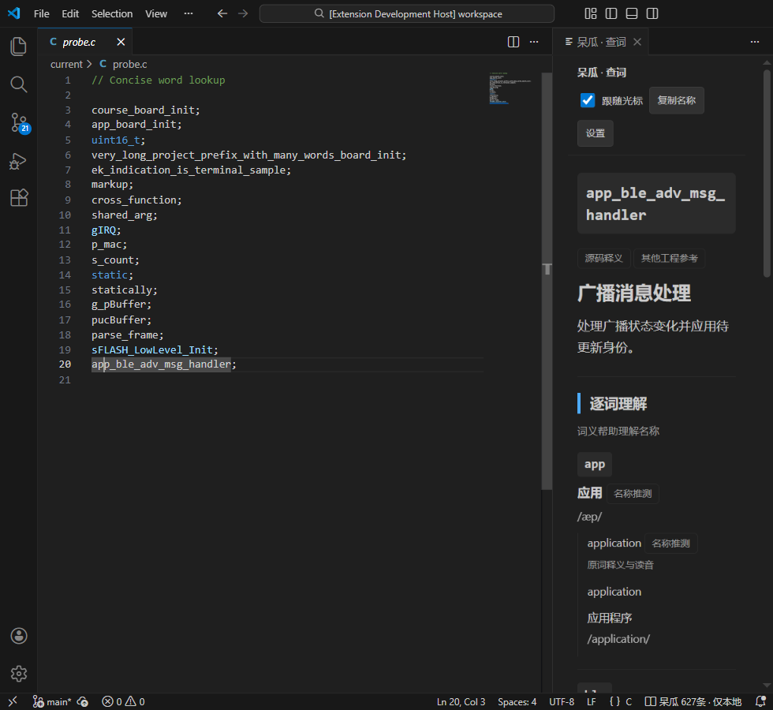

# 0.7.0：固定面板逐词学习验证记录

日期：2026-11-19。目标环境：Windows 10 x64。
隔离宿主：VS Code 1.107.1。

## 交付内容

固定面板新增逐词中文、分行音标和缩写原词信息。
源码命中后仍提供逐词学习。
原词信息和其余词义默认全部展开。
悬停内容与整名查询优先级保持现状。

面板推测使用清单启用的本地规则。
推测结果显示「名称推测」。
条件未满足时，结果只列为可能含义。
普通词典的不同含义单独列出。
词库缺失和音标冲突保留明确提示。

工具栏支持跟随、锁定、复制名称和设置。
同名补充保留节点、文本选择和阅读位置。
新名称清除旧选择并回到顶部。
旧请求不能覆盖新名称或关闭后的面板。

内部模型使用分支关联词义、全称与原词。
模型保留原始规则、来源和审核状态。
学习缓存最多保留 64 个查询快照。
词库变化会使缓存失效。

## 词库变更

词库与插件分别位于独立 Git 仓库。
本次词库新增 `words/03-panel-learning.json`。
清单明确启用这份文件。
文件提供 APP、MSG、HANDLER 的面板推测。
ADV 推测要求名称中包含 ble。
原有 ADV 大写精确匹配保持不变。

`learning_only` 词条不参与普通查询或音标维护匹配。
新增可选字段已同步 TypeScript 和 Python 校验器。
新增释义保留 `unreviewed` 状态。
生产词库校验结果为 62 条词语、33 条命名、502 条源码符号。

示例使用真实启用词库和本机 ECDICT 查询通过。
5 个词段分别获得应用、低功耗蓝牙、广播、消息与处理者释义。
Bluetooth 原词没有可靠音标，继续显示缺失。
原词 application、advertising、message、Low、Energy 有可用音标。

## 自动验证

以下检查的退出码均为 0。

| 检查 | 结果 |
| --- | --- |
| `npm.cmd --prefix plugin test` | 143 项通过 |
| `python -X utf8 -m unittest discover -s tests -p test_*.py` | 40 项通过 |
| `python -X utf8 validator/validate.py --library dictionaries` | 词库通过校验 |
| `node scripts/test-ui.cjs` | 18 组界面检查通过 |
| `pwsh.exe -NoProfile -File build.ps1` | 构建与包内校验通过 |
| `python -X utf8 scripts/check-vsix.py plugin/daigua-translator.vsix` | 运行模块、资源与排除规则通过 |
| `pwsh.exe -NoProfile -File scripts/test-vscode.ps1 -VsixPath plugin/daigua-translator.vsix` | 实际安装后 10 组宿主检查通过 |

界面报告：
`C:\Users\005869\AppData\Local\Temp\daigua-ui-0M5qzV\report.json`

安装包宿主报告：
`C:\Users\005869\AppData\Local\Temp\daigua-host-c620f865daf142e983a1944682b65025\report.json`

两个报告均为 `passed: true`。
验证使用临时配置、扩展目录和工作区。
验证没有修改用户日常 VS Code 配置。
界面验证使用 Chromium 调试接口。
验证没有控制真实鼠标或键盘。

### 覆盖重点

- 源码命中后的 5 个词段与逐词音标。
- 原词缺失、其余词义、多义推测与条件未满足。
- 源码读音优先、重复位置、读音冲突和对齐失败。
- 面板学习不改写悬停与共享查询数据。
- 词库重载、缓存失效、异步替换和关闭后的旧请求。
- 锁定期间完成同次补充，解锁恢复跟随。
- 联网整名补充前后保留本地内容与文本选择。
- 四类主题、原生控件焦点与复制完整名称。
- 实测 320 px 两列布局和 280 px 上下布局。
- 跨工程候选、参数所属函数及调试来源。
- 设置页布局、目录选择与完整提示词复制回归。
- HTML 和 Markdown 特殊字符保持字面内容。

### 验证中的修正

旧界面断言曾要求隐藏全部其他词典含义。
本次按新需求分别检查主词义与其他词典含义。
悬停的旧断言保持原样。

界面异步刷新和剪贴板写入需要等待状态完成。
测试已改为等待对应名称、学习状态和剪贴板内容。
联网译文区已恢复稳定的组件标识。
最终重跑通过，先前失败证据保留在临时目录。

首次学习补充耗时为 99.02 ms，缓存查询为 0.16 ms。
这组数据来自整名查询后的本机单次测量。
这组数据不代表冷磁盘性能或性能保证。

## 安装包

路径：[daigua-translator.vsix](../plugin/daigua-translator.vsix)

- 版本：0.7.0。
- 大小：812,600 字节。
- SHA-256：`c8ef1aa65d52a371832381d09efc69ad206eb162deb2e96d5e3187acdace1776`。

安装包包含新面板模块与更新后的维护提示词。
安装包不包含词库、完整 ECDICT、测试代码或设计参考图。
使用新推测规则时，需要同时取得更新后的独立词库。
本次没有安装到用户日常 VS Code，也没有自动提交或推送 Git。

## 真实界面截图

下列截图来自最终隔离 Webview，不是生成参考图。
示例文件位于测试工作区，因此显示「其他工程参考」。
实际工程标签仍取决于清单中的源码根目录。

## 验证边界

自动检查验证查询规则和界面行为。
自动检查不代表全部源码释义已人工核实。
本次没有验证硬件上的蓝牙行为。
本次没有人工逐条核对词库语义或所有用户自定义主题。
用户仍可直接使用，无需逐条审核。
