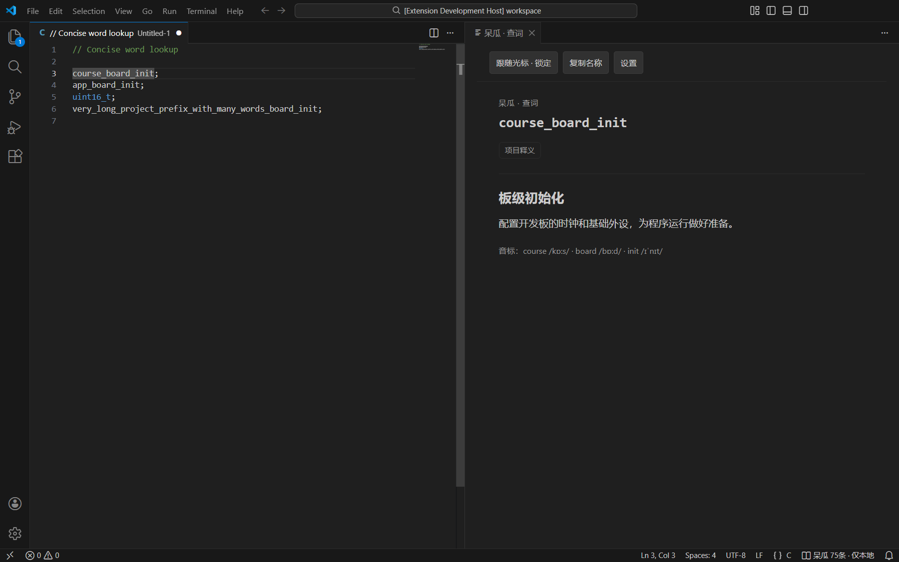
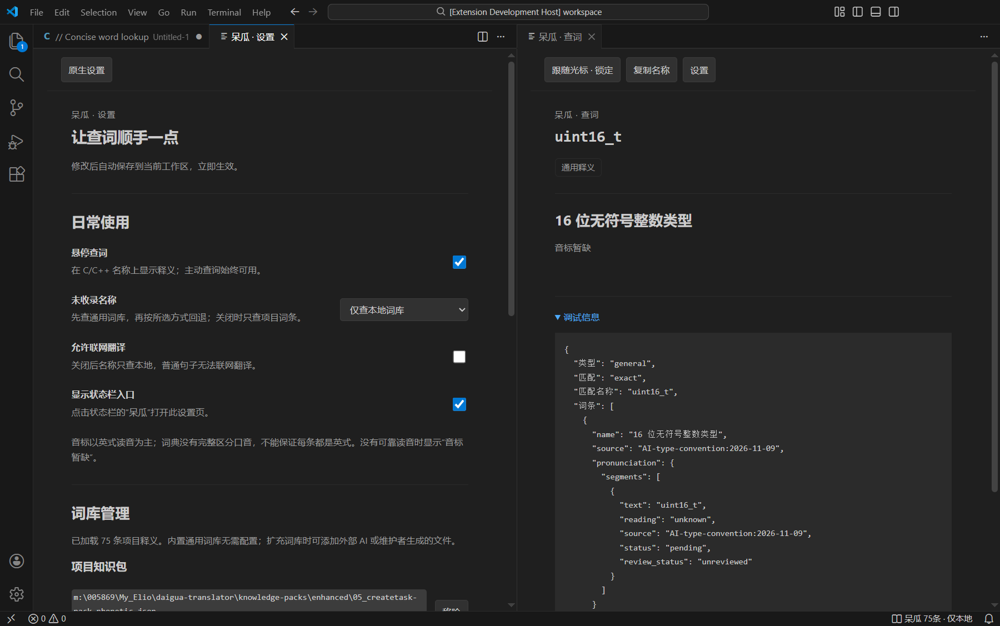

# 0.5.0：简明查词与通用释义

日常先看名称的含义：英文名称、中文名、一句话用途和音标。实现细节与来源保留在数据中，通过调试模式查看。

## 使用

1. 安装 `plugin/daigua-translator.vsix` 并重新加载 VS Code。
2. 在 C/C++ 名称上悬停，或右键选择“在面板中查看”。固定面板默认跟随光标，停留约 350 毫秒后更新；“锁定”保留当前词条，“复制名称”复制原始名称。
3. 点击状态栏的“呆瓜”打开中文设置页。设置按“日常使用、词库管理、调试与诊断”分组，修改后自动保存；页面明确显示保存到用户还是当前工作区。
4. 在词库管理中添加、移除项目知识包和技术库，或选择 ECDICT 索引目录。通用词库内置，不配置 ECDICT 也可使用；完整词典与 Python 不随插件安装。
5. 日常保持“显示调试信息”关闭。排错时开启，可查看原始详细说明、完整路径、读音来源、名称匹配方式和错误信息。

普通句子及其他语言仍可通过右键或“输入文本翻译”主动查询；无编辑器时打开查词面板，不修改源文本。联网总开关继续生效。

## 内容规则

`course_board_init` 日常示例：

```text
course_board_init
板级初始化
配置开发板的时钟和基础外设，为程序运行做好准备。
音标：course /kɒ:s/ · board /bɒ:d/ · init /ɪˈnɪt/
项目释义
```

- 不显示当前频率、引脚编号、文件位置、声明、参数表和返回值。必要的定义信息保留，例如 `uint16_t` 的“16 位”。
- 音标行不重复显示来源或“英式优先”；设置页说明音标以英式为主且不能保证每条口音。缺失时显示“音标暂缺”，部分缺失时只列可靠读音，并提示“部分音标暂缺”。
- 现有 75 条项目词条、对应音标增强包及示例包已增加 `summary_zh`。原有 `description_zh`、来源与读音状态保留。旧包未提供简明用途时，只显示原有中文名称，不自动截取或改写长说明。
- 同名候选全部显示；索引参数显示所属函数。未命中完整释义时，每个拆词默认显示首个非空义项，固定面板可以展开其余词义。

## 通用词库

查询顺序为项目精确匹配、通用精确匹配、通用名称推测、原有联网／离线回退。“不自动解释”模式仅显示项目命中；主动查询不受该悬停模式限制。

本版内置六类完整名称：`board_init`、`system_clock_config`、`led_set`、`led_toggle`、`uart_write`、`uart_read`。支持下划线与驼峰拆词归一化。后缀推测至少匹配两个完整词段，优先最长后缀，例如 `course_board_init` 可复用 `board_init`，并标注“通用释义 · 名称推测”。`board_deinit`、单独 `init` 不会误用 `board_init`。

只有带非空 `summary_zh`、没有限定 `symbol`、不含数字的完整名称条目参与通用推测。定宽整数类型保留原有精确匹配规则。额外技术库优先于内置词库；同名项目解释始终优先，不用通用约定覆盖项目中的特殊用途。

用户提供工程代码，由外部 AI 或维护者持续完善词库文件。通用释义只记录稳定含义，不把某个工程中的 LED、DWT、波特率等实现当作所有项目的保证。插件运行时无需 AI、模型密钥或个人逐条审核。

## CLI 与脚本验证

统一的测试工具入口、执行顺序、运行环境和报告位置见 [测试工具与验证方法](../scripts/README.md)。验证通过 CLI、隔离扩展宿主和 Chromium 调试接口完成，不操作真实鼠标或键盘。

VS Code 原生悬停的大小和字体由编辑器控制；其他插件提供的类型声明仍可能和呆瓜内容同时出现。呆瓜不修改其他插件设置。

## 本次验证记录（2026-11-09）

- 插件 85 项测试通过，Python 33 项测试通过；完整验证脚本与离线冒烟检查通过。
- VS Code 1.107.1 隔离宿主的 6 组检查通过，覆盖简明释义、参数、调试开关、通用推测、多行主动查询，以及与另一悬停提供者共存。报告：`C:\Users\005869\AppData\Local\Temp\daigua-host-1699670c73b2428aba3747eb51c5abe7\report.json`。
- CLI 界面脚本的 6 组检查通过；检查实际 Webview 的三类主题、窄面板、真实页面事件与配置保存。报告及六张截图：`C:\Users\005869\AppData\Local\Temp\daigua-ui-mBVfUw`。这些验证没有操作鼠标或键盘。
- 对照修改前的 Git 数据，五份知识包的原有字段逐项保持一致，只增加简明用途。
- VSIX 0.5.0 内容检查通过，包含新增运行模块和通用词库，排除了测试代码和完整 ECDICT。安装包为 `plugin/daigua-translator.vsix`，791,930 字节；SHA-256：`e522d4fa1e3da34c58e3f48c4910cb436d60ecf88edc9bbb4c9023d350a9776f`。
- 打包工具提示仓库未提供插件 LICENSE 文件；未擅自为项目指定许可证。




